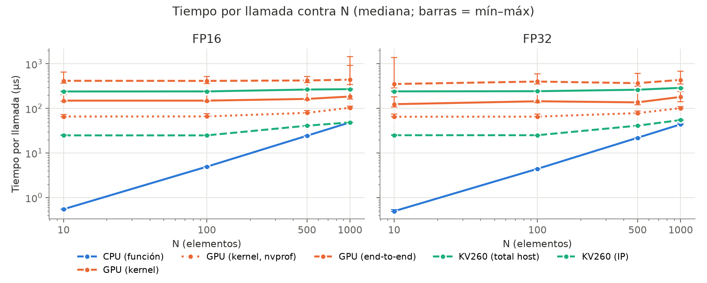

# Laboratorio Semana 13: Softmax en CPU, GPU y FPGA

## EL5859 Computación Heterogénea | II Semestre 2026

Implementación de softmax numéricamente estable en FP16 y FP32 sobre tres plataformas, comparando tiempo, energía y exactitud para `N ∈ {10, 100, 500, 1000}`:

$$m = \max_i x_i, \qquad y_i = \frac{e^{x_i - m}}{\sum_j e^{x_j - m}}$$

| Parte | Plataforma | Responsable |
|---|---|---|
| CPU | Jetson Nano 2GB, Cortex-A57 | KD |
| GPU | Jetson Nano 2GB, Maxwell 128 núcleos (CUDA 10.2) | FA |
| FPGA (HLS) | Kria KV260, Zynq UltraScale+ `xck26` (Vitis 2026.1) | KA |
| Pruebas físicas, energía e integración | KV260 y consolidación de resultados | RO |

## Estructura

```
CPU/         softmax_cpu.cpp, run_all.sh, resultados/ (CSV, tegrastats, entorno)
GPU/         softmax_cuda.cu, run_gpu.sh, perfilar.sh, resultados/, perfilador/ (nvprof)
FPGA/        softmax_hls.{h,cpp}, softmax_tb.cpp, run_hls.tcl, build_bitstream.tcl,
             extraer_reportes.py, host_kv260.py, reportes/, overlay/, resultados/
Resultados/  consolidar.py, tablas_comparativas.{md,csv}, perfil_gpu_nvprof.md,
             graficas/, analisis.md  (respuestas a las preguntas)
```

## Protocolo común

- **Entrada:** generador `splitmix64`, semilla **12345**, `x = -4 + 8u` con `u` uniforme de 53 bits. Es la misma en C++, CUDA, el testbench HLS y el host Python.
- **Referencia:** softmax en `double` con `std::exp` (FP64). Se reporta error absoluto y relativo máximo.
- **Validación:** suma ≈ 1, todas las salidas en [0, 1] y la posición del máximo igual a la de FP64.
- **Medición:** corrida de calentamiento descartada, al menos 5 mediciones por configuración, mediana/mínimo/máximo, datos crudos en CSV.
- **Jetson Nano:** modo de potencia **5W (modo 1)**, 2 núcleos activos, igual para CPU y GPU.
- **FP16:**
  - En la CPU se usa `__fp16` (g++ 7.5 no tiene `_Float16`); la exponencial y la suma se hacen en FP32.
  - En la GPU se usa `__half`.
  - En HLS se usa `half`; la variante 4 calcula internamente en FP32.

## Comandos utilizados

### CPU (Jetson Nano)

```bash
cd CPU
g++ -O3 -std=c++17 -march=native softmax_cpu.cpp -o softmax_cpu -lm
./run_all.sh            # validación + 5 mediciones x N x precisión + ventana de potencia, con tegrastats
```

### GPU (Jetson Nano)

```bash
cd GPU
nvcc -O3 -std=c++14 softmax_cuda.cu -o softmax_cuda
nvpmodel -q
./run_gpu.sh            # 1000 mediciones de kernel (cudaEvent) y end-to-end por N y precisión
sudo ./perfilar.sh      # nvprof requiere root en Jetson (ERR_NVGPUCTRPERM)
```

### FPGA (PC con Vitis/Vivado 2026.1 y luego la KV260)

```bat
vitis-run --mode hls --tcl run_hls.tcl                                  # C-sim + síntesis + cosim, 5 variantes x 2 precisiones
vivado -mode batch -source build_bitstream.tcl -tclargs fp32            # bitstream + hwh
vivado -mode batch -source build_bitstream.tcl -tclargs fp16
```

```bash
python3 FPGA/extraer_reportes.py                                         # -> FPGA/resultados/tabla_hls.csv
# en la Kria:
sudo bash -c 'source /etc/profile.d/pynq_venv.sh && python3 host_kv260.py --bit overlay/softmax_fp32.bit --precision fp32'
sudo bash -c 'source /etc/profile.d/pynq_venv.sh && python3 host_kv260.py --bit overlay/softmax_fp16.bit --precision fp16'
```

Los detalles de las variantes HLS están en [`FPGA/README.md`](FPGA/README.md).

### Consolidación

```bash
python3 Resultados/consolidar.py      # tablas_comparativas.{md,csv}, perfil_gpu_nvprof.md, graficas/*.png
```

## Resultados

Las tablas completas están en [`Resultados/tablas_comparativas.md`](Resultados/tablas_comparativas.md) y el análisis con las respuestas a las preguntas en [`Resultados/analisis.md`](Resultados/analisis.md).

Resumen del tiempo por llamada (mediana, µs):

| Plataforma | Medida | FP16, N=10 | FP16, N=1000 | FP32, N=10 | FP32, N=1000 |
|---|---|---|---|---|---|
| CPU | función | 0.55 | 48.70 | 0.50 | 43.93 |
| GPU | kernel (nvprof) | 65.74 | 103.45 | 64.99 | 101.46 |
| GPU | end-to-end | 416.16 | 441.37 | 352.59 | 436.78 |
| KV260 | total host | 239.67 | 270.45 | 240.95 | 289.41 |
| KV260 | IP (desde host) | 24.85 | 48.59 | 25.05 | 54.83 |



## Limitaciones

- La **Jetson Nano 2GB no tiene sensor de potencia** (INA3221), por lo cual `tegrastats` no reporta `POM_5V_IN` y no se reporta energía de CPU ni GPU. No se llenó con estimaciones.
- La energía de la KV260 se mide con su **INA260 (U14)**, que incluye todo el SOM (PS + PL + DDR). Se reporta también la potencia en reposo (3.15 W). FP32 medido en `kria-85`; FP16 y FP32 medidos en `kria-85`.
